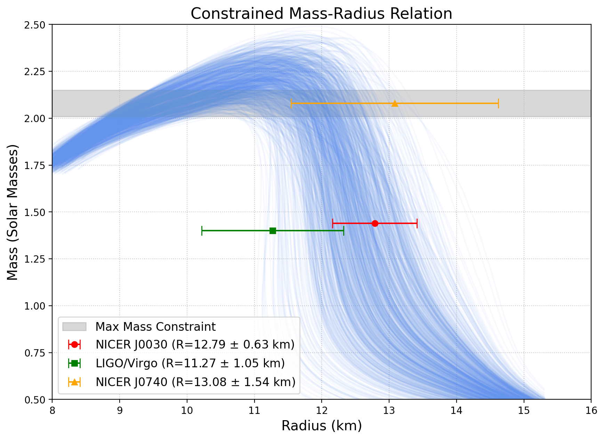
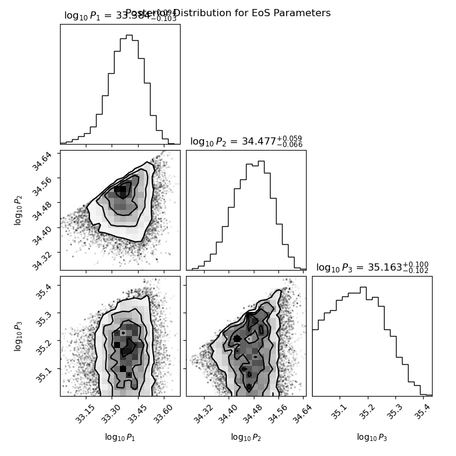
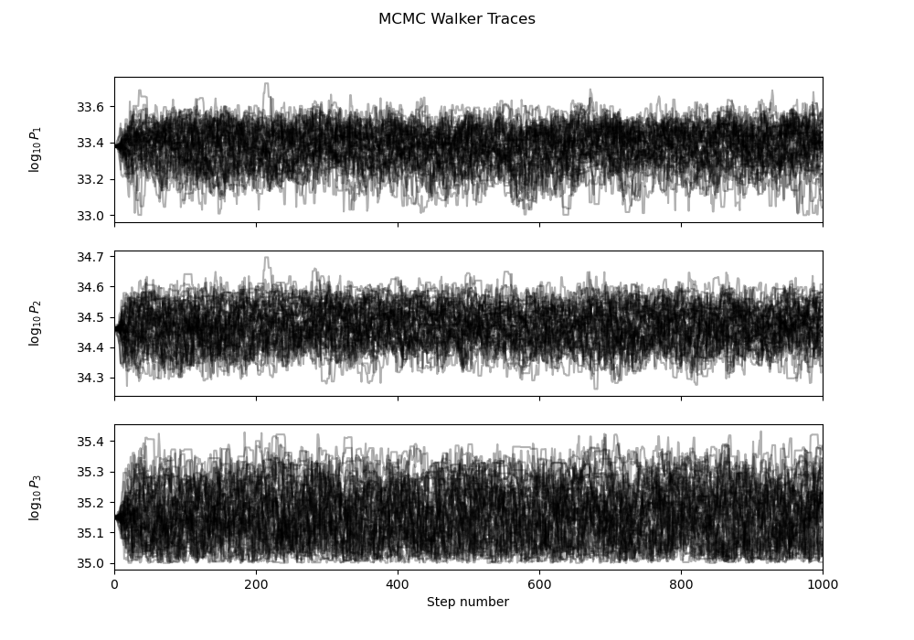

# Bayesian Inference of the Neutron Star Equation of State

This project constrains the neutron star (NS) Equation of State (EoS) by performing a Bayesian MCMC analysis on a 3-parameter piecewise polytropic EoS model.

The likelihood uses three multi-messenger astronomical observations, each reduced to a Gaussian on the radius at a fixed mass:
1.  **LIGO/Virgo:** The gravitational wave event GW170817 (using the EoS-insensitive radius posteriors).
2.  **NICER (PSR J0030+0451):** The mass-radius posteriors for the 1.44 M solar mass pulsar.
3.  **NICER (PSR J0740+0620):** The mass-radius posteriors for the high-mass ~2.08 M solar mass pulsar. 

For the full theoretical background and derivations, see [PHYSICS.md](./PHYSICS.md).


---

## Results

> **Note:** `mcmc_results.h5` and the plots below were produced before the energy-density correction (see [Changelog](#changelog)) and have not been regenerated. The corrected posterior, obtained by reweighting this chain, is summarized in the Changelog and stored in `reweighted_epsfix.h5`. Re-run `run_mcmc.py` and `plot_results.py` to regenerate the chain and plots.

The MCMC simulation, run with 50 walkers for 2,500 steps, successfully found the family of EoS models that are consistent with all three data sets.

### 1. Constrained Mass-Radius Relation

The final "credible band" shows the family of EoS models that are statistically favored. The plot visualizes the core tension in modern astrophysics: the EoS must be "soft" enough to be consistent with the LIGO/Virgo data (green) while simultaneously being "stiff" enough to support the existence of massive pulsars like J0740 (orange) and the general 2.01 M solar mass limit (grey).



### 2. Parameter Posterior Distributions

The corner plot shows the final probability distributions for the three EoS parameters (the log-pressure at 1.85, 3.7, and 7.4 times nuclear saturation density). This shows the specific values and correlations that a physical EoS must have to be consistent with observations.



### 3. MCMC Convergence

The walker traces show that the MCMC successfully converged on a stable solution after an initial burn-in period.



---

## How to Run This Project

This project is structured into three main Python files that work together. The correct sequence to reproduce the results is:

1.  `tov_model.py`: **This is the core physics engine.** It contains the functions for building the EoS, its energy density, and solving the TOV equations. It is imported as a module by the other scripts; running it directly performs a test and evaluates the likelihood on example parameters.

2.  `run_mcmc.py`: **This is the main computation script.** It imports the engine from `tov_model.py` and runs the MCMC simulation using `emcee` and `multiprocessing`. This is the script that takes several hours.

3.  `plot_results.py`: **This is the analysis script.** After the MCMC is done, you run this script. It imports the *same* physics functions from `tov_model.py` and loads the results from the MCMC run (`mcmc_results.h5`) to generate all the final plots.

### Step-by-Step Instructions

#### 1. Setup
Make sure you have all the necessary files in the same directory:
* `tov_model.py`
* `run_mcmc.py`
* `plot_results.py`
* `EoS-insensitive_posterior_samples.dat`
* `J0030_data.dat`
* `J0740_data.dat`

#### 2. Depedencies
And install the required libraries:
```bash
pip install numpy scipy matplotlib emcee corner h5py
```

#### 3. Run the TOV engine
Run the [tov_model.py](tov_model.py) file. 
```bash
python tov_model.py
```

#### 4. Run the MCMC Simulation
Execute the [run_mcmc.py](run_mcmc.py) script from your terminal. This will use all available CPU cores to run the simulation.

```bash
# To run the full, 2500-step (500 burn + 2000 steps) simulation:
python run_mcmc.py --n-burn 500 --n-steps 2000
```
This will run for several hours and create a new file: mcmc_results.h5.

#### 5. Generate the Plots
Once mcmc_results.h5 exists, run the plotting script:

```bash
python plot_results.py
```

This script will load mcmc_results.h5, generate all three plots (Trace, Corner, and M-R Band), and save them as .png files in your folder.

---

## Changelog

**Energy-density correction (fix-energy-density branch).**

* **TOV equations.** The solver used the rest-mass density ρ where the TOV equations need the total energy density ε/c²: in dM/dr, in the (ε + P) factor of dP/dr, and in the central conditions. It now uses ε(P) = (1 + aᵢ)ρc² + Kᵢρ^Γᵢ/(Γᵢ − 1), with aᵢ set by continuity of ε at each dividing density (Read et al. 2009). See PHYSICS.md.
* **Central series expansion.** The P(r₀) correction term divided by c² instead of c⁴. Its effect was about 0.1% of P_c.
* **One copy of the physics.** `run_mcmc.py` and `plot_results.py` each carried their own copy of the EoS/TOV code. Both now import it from `tov_model.py`. The test code in `tov_model.py` runs only when the file is executed directly.
* **Effect.** The MCMC has **not** been re-run yet, so `mcmc_results.h5` and the plots are still pre-fix. Evaluating 500 draws of the old posterior with old and corrected physics:

  | | M_max [M☉] median [90%] | R_1.4 [km] median [90%] |
  | :--- | :--- | :--- |
  | Old posterior, old physics | 3.17 [2.49, 3.73] | 12.42 [11.77, 13.23] |
  | Same draws, corrected physics | 2.74 [2.08, 3.29] | 11.99 [11.23, 12.68] |

  For a fixed EoS the correction lowers M_max by about 0.44 M☉ and R_1.4 by about 0.42 km (medians). 2.8% of the old posterior draws no longer reach 2.01 M☉.

* **Corrected posterior by importance reweighting.** The prior is unchanged by the fix, so the old chain can be reweighted with w = L_new / L_old (`reweight_epsfix.py`, 2000 draws, output in `reweighted_epsfix.h5`). The effective sample size is 605 (30%), and the largest single weight is 1%, so the reweighted posterior is reliable for medians and 90% intervals:

  | | M_max [M☉] | R_1.4 [km] | R_2.08 [km] | log P₁ | log P₂ | log P₃ |
  | :--- | :--- | :--- | :--- | :--- | :--- | :--- |
  | Pre-fix posterior (old physics) | 3.17 [2.49, 3.73] | 12.42 [11.77, 13.23] | 12.69 [11.41, 13.37] | 33.21 [33.03, 33.42] | 34.79 [34.14, 35.41] | 35.79 [35.11, 36.43] |
  | Corrected posterior (reweighted) | 3.03 [2.31, 3.32] | 12.39 [11.77, 13.18] | 12.51 [10.77, 13.27] | 33.28 [33.05, 33.50] | 35.06 [34.24, 35.45] | 36.01 [35.25, 36.47] |

  R_1.4 is essentially unchanged because the data pin it. To keep the same radii with the extra gravitating energy, the posterior moves to higher pressures, and the upper ends of log P₂ and log P₃ now reach the prior bounds (35.5, 36.5). M_max stays above 3 M☉, and most of these EoSs are acausal (causality is not enforced). A full re-run of `run_mcmc.py` would refine the tails but is not needed for the central values. Old results and engines are in `results_before_epsfix/`.

---

## Reproducibility

All data files and posterior samples used in this project are publicly available:

1. LIGO/Virgo GW170817 posteriors (Abbott et al., 2018)

2. NICER PSR J0030+0451 (Miller et al., 2019)

3. NICER PSR J0740+0620 (Riley et al., 2021)

The entire pipeline can be reproduced on any system with Python ≥ 3.8.

---

## References

- **LIGO/Virgo:** Abbott et al. (2018), *Phys. Rev. Lett.*, 121, 161101.  
- **NICER (J0030):** Miller et al. (2019), Riley et al. (2019), *ApJ Letters*, 887.  
- **NICER (J0740):** Miller et al. (2021), Riley et al. (2021), *ApJ Letters*, 918.

---
